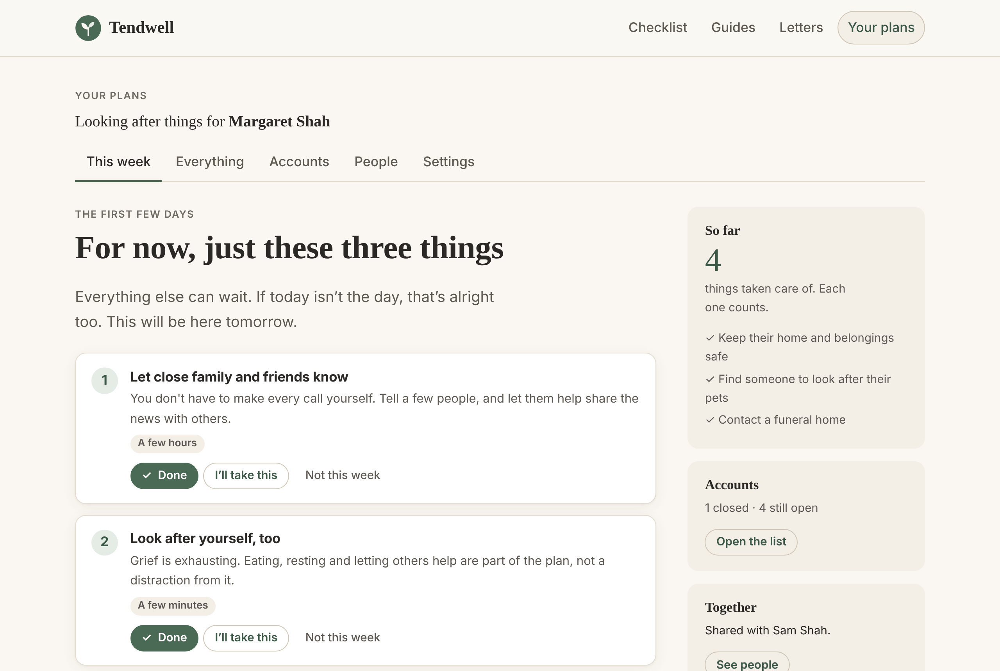
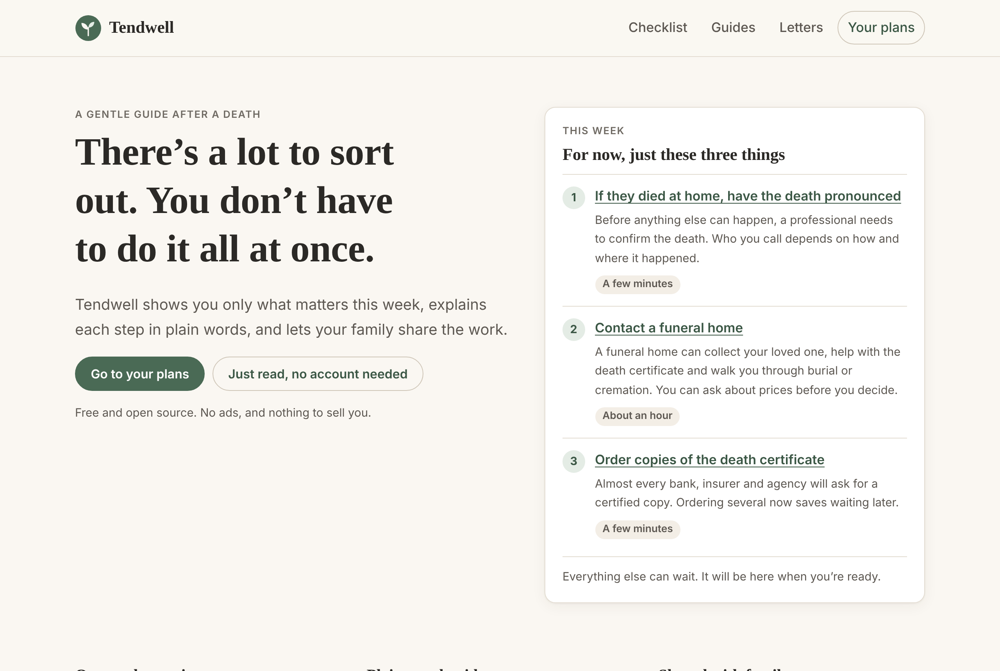
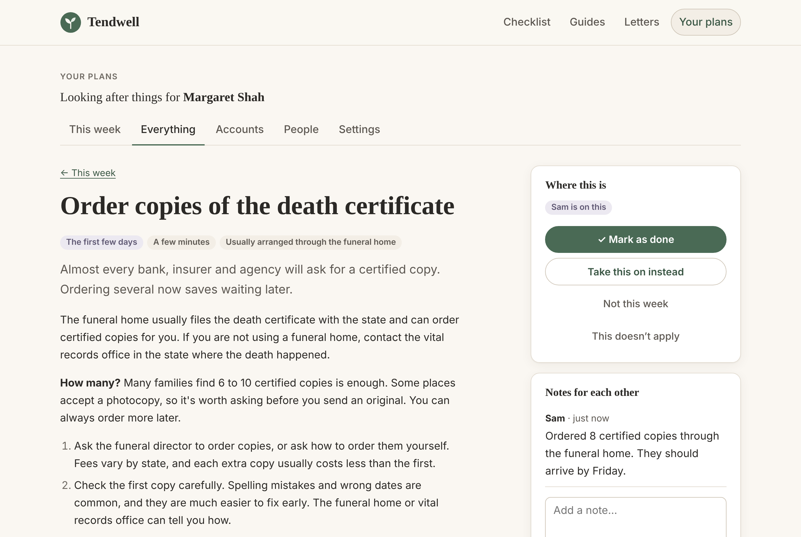
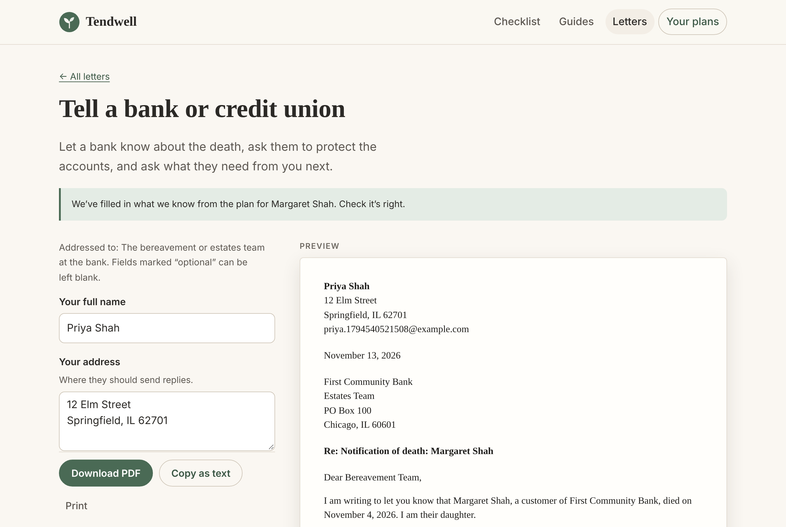
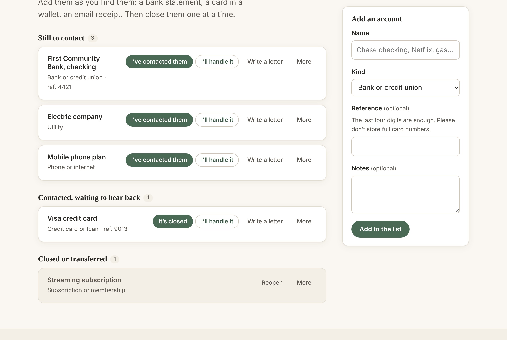
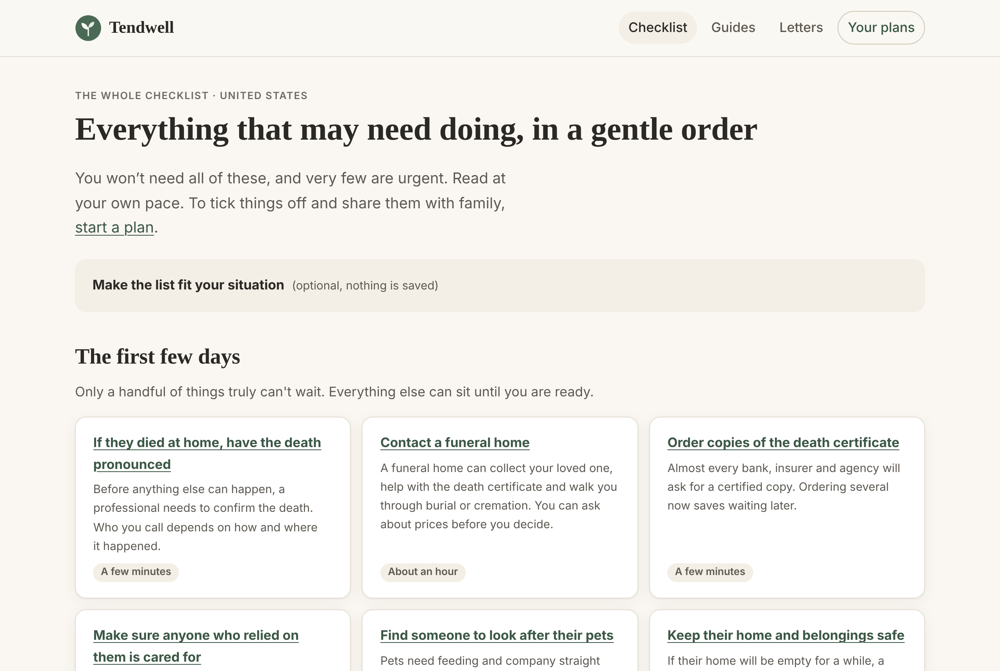
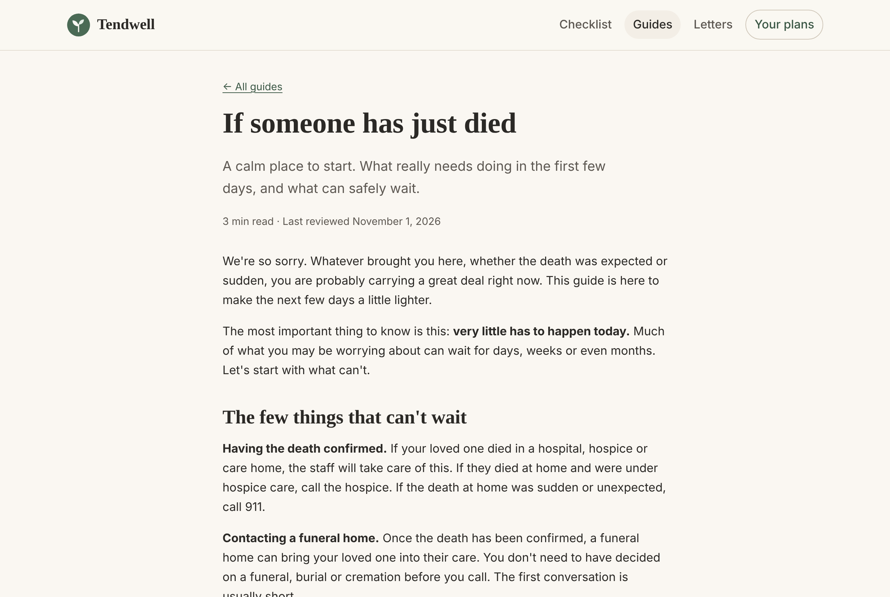
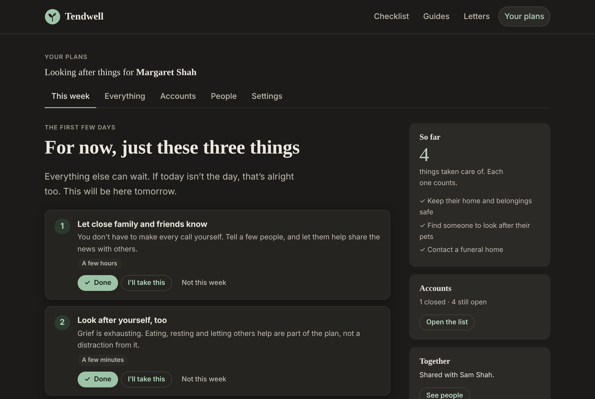
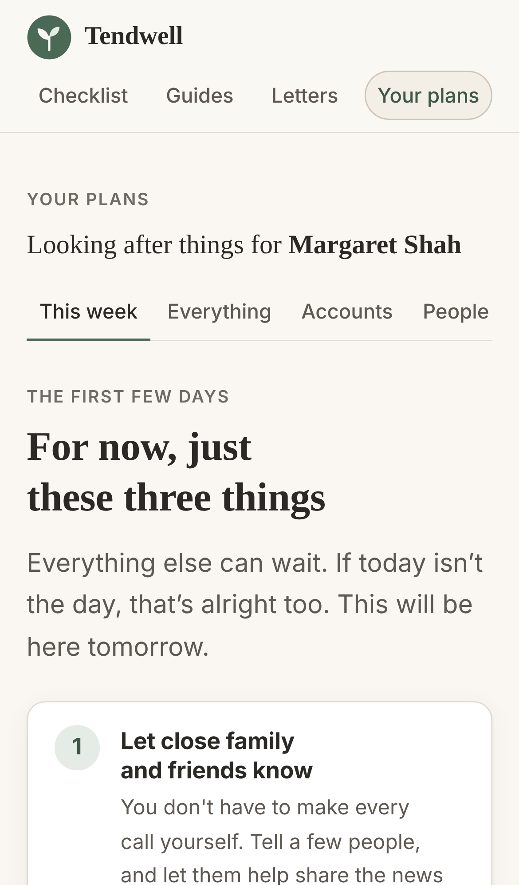

<div align="center">


# Tendwell

**A gentle guide after a death.**

Tendwell shows a grieving family only what matters this week, explains each step in plain words,
gives them letters they can download, and lets siblings share the work.

[](https://github.com/lobojoel2003/Tendwell/actions/workflows/ci.yml)
[](https://github.com/lobojoel2003/Tendwell/actions/workflows/codeql.yml)
[](https://github.com/lobojoel2003/Tendwell/releases/latest)
[](https://github.com/lobojoel2003/Tendwell/pkgs/container/tendwell)
<br />
[](LICENSE)
[](content/LICENSE)
[](.nvmrc)
[](https://svelte.dev/docs/kit)

<br />



</div>

## The problem

When someone dies, the people who loved them inherit a job nobody trains for. They have to order
death certificates, claim benefits, close accounts and cancel subscriptions, often while grieving
and with no idea where to start.

- **It takes a long time and costs a lot.** The bereaved can spend up to **500 hours over 13 months**
  on this admin, and the average cost to them exceeds **$12,000**. These figures come from Empathy's
  own Cost of Dying report, via
  [Hospice News](https://hospicenews.com/2024/03/12/grief-care-tech-company-empathy-raises-47m-in-sseries-b-round/).
- **The best help is hard to reach.** Empathy, the leading app, has raised $90 million and sells
  mainly through employers and insurers such as MetLife, so many families only get it as a work
  benefit
  ([Hospice News](https://hospicenews.com/2024/03/12/grief-care-tech-company-empathy-raises-47m-in-sseries-b-round/)).
  In 2021 it charged $65 after a free month
  ([Freethink](https://www.freethink.com/hard-tech/what-to-do-when-someone-dies)).
- **Open source hasn't filled the gap.** The best open-source project we found, death-binder, has 14
  stars, was last updated in 2023, and helps you plan ahead rather than settle things after a death.

Tendwell is free, open source and self-hostable, and is built for the weeks after a death.

## What makes it gentle

|                        |                                                                                                                                              |
| ---------------------- | -------------------------------------------------------------------------------------------------------------------------------------------- |
| **One week at a time** | A plan never opens on a list of 40 tasks. It says _“For now, just these three things”_, picked from the earliest open steps.                 |
| **Honest urgency**     | Nothing looks urgent unless it is. Only real deadlines (like the 60-day COBRA window) are marked, calmly.                                    |
| **Permission to rest** | Any step can be set aside with _“Not this week”_. It rests for seven days, then comes back.                                                  |
| **Shared with family** | Invite siblings with a private link. Anyone can say _“I’ll take this”_, so nobody makes the same call twice and nobody carries it all alone. |
| **Plain words**        | Every step says why it matters, how to do it, and what can safely wait.                                                                      |
| **No account to read** | The checklist, guides and letters are open to everyone, with nothing to sign up for.                                                         |

## Features

<table>
  <tr>
    <td width="50%"></td>
    <td width="50%"></td>
  </tr>
  <tr>
    <td><b>A calm start.</b> Read the first three steps before signing up for anything.</td>
    <td><b>Steps that explain themselves</b>, with who's handling it and notes for each other.</td>
  </tr>
  <tr>
    <td></td>
    <td></td>
  </tr>
  <tr>
    <td><b>Letters as PDFs.</b> Fill in a few details, see a live preview, then download, print or copy. Nothing is stored.</td>
    <td><b>An accounts list</b> that moves each bank, bill and subscription from “to contact” to “closed”.</td>
  </tr>
  <tr>
    <td></td>
    <td></td>
  </tr>
  <tr>
    <td><b>The whole checklist</b>, tailored by ten optional questions. “Not sure” keeps a step in, just in case.</td>
    <td><b>Nine plain-word guides</b>, from the first hours to probate, benefits, debts and digital accounts.</td>
  </tr>
  <tr>
    <td></td>
    <td align="center"></td>
  </tr>
  <tr>
    <td><b>Easy on tired eyes</b>, with automatic dark mode.</td>
    <td><b>Made for phones</b>, and it works without JavaScript too.</td>
  </tr>
</table>

### What's inside

- **40 checklist steps** for the United States, across four stages: the first days, the first weeks,
  the first months, and “when you're ready”.
- **9 guides**: if someone has just died, looking after yourself, death certificates, who to tell,
  executors and probate, money and debts, benefits and insurance, digital life, and sharing the work.
- **8 letter templates**: banks, credit bureaus, utilities, subscriptions, landlords, employers,
  life insurance, and a general account-closing letter.
- **Shared plans** with invite links, “I'll take this”, notes, an activity feed and an accounts list.
- **Privacy first**: no trackers, analytics or third-party scripts; letter details are never stored;
  people can delete their account at any time.

## Run it

### With Docker (recommended)

```bash
docker run -d --name tendwell -p 3000:3000 -v tendwell-data:/data -e ORIGIN=http://localhost:3000 ghcr.io/lobojoel2003/tendwell:latest
```

Then open http://localhost:3000. Images are published for `linux/amd64` and `linux/arm64`.

Or with Docker Compose, using the included [`docker-compose.yml`](docker-compose.yml):

```bash
docker compose up -d
```

For a public server, put Tendwell behind HTTPS (for example with Caddy or nginx) and set `ORIGIN` to
its public address, like `https://tendwell.example.org`.

### From a release bundle

Each [release](https://github.com/lobojoel2003/Tendwell/releases) includes a ready-built
`tendwell-vX.Y.Z.tar.gz`. With Node.js 22.17 or newer:

```bash
tar -xzf tendwell-v1.0.0.tar.gz && cd tendwell-v1.0.0
```

```bash
npm ci --omit=dev --ignore-scripts && ORIGIN=http://localhost:3000 node build
```

### From source

```bash
git clone https://github.com/lobojoel2003/Tendwell.git && cd Tendwell
```

```bash
npm install && npm run dev
```

### Configuration

| Variable                                           | Default                                            | What it does                                                                                     |
| -------------------------------------------------- | -------------------------------------------------- | ------------------------------------------------------------------------------------------------ |
| `ORIGIN`                                           | _(none)_                                           | The public address, like `https://tendwell.example.org`. Needed in production for forms to work. |
| `PORT`                                             | `3000`                                             | Port to listen on.                                                                               |
| `DATABASE_PATH`                                    | `data/tendwell.db` (`/data/tendwell.db` in Docker) | Where the SQLite database lives. Back this file up.                                              |
| `PROTOCOL_HEADER`, `HOST_HEADER`, `ADDRESS_HEADER` | _(none)_                                           | Trust these headers from a reverse proxy, for example `x-forwarded-proto`.                       |
| `BODY_SIZE_LIMIT`                                  | `512K`                                             | Largest request body accepted.                                                                   |

The database is created and migrated automatically on start. `/healthz` reports the version, build
number, commit and database status, and the Docker image uses it as its health check.

Tendwell doesn't send email. If someone forgets their password, the person running the server can
give them a new one:

```bash
docker exec tendwell node scripts/reset-password.js someone@example.com
```

## How it works

Tendwell is a [SvelteKit](https://svelte.dev/docs/kit) app with a SQLite database
([better-sqlite3](https://github.com/WiseLibs/better-sqlite3)), rendered on the server so every page
works without JavaScript and gets faster with it.

- **Content as files.** Every step, guide and letter is Markdown with YAML front matter in
  [`content/`](content/). It's validated against a schema at build time and in CI, so a typo in a
  volunteer's pull request is caught with a message that names the file and the field.
- **Letters to PDF.** Templates use a tiny `{{field}}` / `{{#if field}}` syntax. The page previews
  the letter live in the browser, and the server renders a clean US Letter PDF with
  [PDFKit](https://pdfkit.org/).
- **“Three things this week”** is a small, pure function in [`src/lib/plan.ts`](src/lib/plan.ts):
  your own steps first, then unclaimed ones from the earliest stage, with real deadlines brought
  forward and resting steps left out. It's fully unit tested.
- **Security**: scrypt password hashing, hashed session and invite tokens, rate-limited sign-in, CSRF
  protection, a strict Content Security Policy, and no third-party code in the browser. See
  [SECURITY.md](SECURITY.md).

```text
content/              Guides, checklist steps, letters, questions (CC BY-SA 4.0)
src/lib/content/      Content schema, parsing and the letter template language
src/lib/server/       Database and migrations, auth, plans, PDF rendering
src/lib/plan.ts       The "three things this week" logic
src/routes/           Pages and endpoints
tests/e2e/            Playwright end-to-end tests
.github/workflows/    CI, release and CodeQL pipelines
```

## Help improve the guides

You don't need to be a programmer. Every guide is a text file you can edit on GitHub: open it, press
the pencil icon, and propose your change. The [content style guide](content/README.md) explains the
format and the tone. If you'd rather describe the problem in your own words,
[open an issue](https://github.com/lobojoel2003/Tendwell/issues/new/choose).

Tendwell currently covers the **United States**. Adding another country or state is mostly writing.
See [adding a region](content/README.md#adding-a-region) and the
[region request form](https://github.com/lobojoel2003/Tendwell/issues/new?template=new-region.yml).

For code changes, see [CONTRIBUTING.md](CONTRIBUTING.md).

## Development

```bash
npm run dev            # development server at http://localhost:5173
npm run check          # type check
npm run lint           # Prettier and ESLint
npm run content:check  # validate everything in content/
npm run test:unit      # Vitest
npm run test:e2e       # Playwright (builds and starts the app)
```

## Versions, builds and releases

Tendwell follows [Semantic Versioning](https://semver.org/). Changes are recorded in
[CHANGELOG.md](CHANGELOG.md).

- **Version**: from `package.json`, for example `1.0.0`.
- **Build number**: the GitHub Actions run number, baked into every CI and release build.
- **Commit**: the exact source revision.

All three appear in the footer of every page (like `v1.0.0 (build 12)`) and at `/healthz`.

Pushing a tag like `v1.1.0` starts the [release pipeline](.github/workflows/release.yml), which:

1. checks the tag matches `package.json` and has a `CHANGELOG.md` entry,
2. runs the full CI suite on the tagged commit,
3. creates a GitHub Release with the changelog notes, a `.tar.gz` and `.zip` bundle, SHA-256
   checksums and build provenance attestations, and
4. publishes the Docker image to `ghcr.io/lobojoel2003/tendwell` as `1.1.0`, `1.1`, `1`, `latest` and
   `build-<number>`, for amd64 and arm64.

### CI/CD

| Workflow                                 | Runs on                                     | What it does                                                                                                                                                                         |
| ---------------------------------------- | ------------------------------------------- | ------------------------------------------------------------------------------------------------------------------------------------------------------------------------------------ |
| [CI](.github/workflows/ci.yml)           | every push to `main` and every pull request | Lint, type check, content validation, unit tests, dependency audit, Playwright end-to-end tests (desktop and mobile), a production build smoke test, and a Docker image health check |
| [Release](.github/workflows/release.yml) | version tags `v*.*.*` (or by hand)          | Everything in CI, then the GitHub Release and the multi-platform Docker image                                                                                                        |
| [CodeQL](.github/workflows/codeql.yml)   | pushes, pull requests, weekly               | Security analysis of the TypeScript and the workflows                                                                                                                                |
| [Dependabot](.github/dependabot.yml)     | weekly                                      | Grouped updates for npm packages, GitHub Actions and the Docker base image                                                                                                           |

## Not legal or financial advice

Tendwell gives general information that is true for many people in the United States. Rules vary by
state and situation. For an estate with property, debts, disagreements or a business, please speak
with a probate lawyer or an accountant.

If you're struggling, you can call or text **988** in the US, any time, to reach the 988 Suicide &
Crisis Lifeline.

## License

- **Code** is licensed under the [GNU Affero General Public License v3.0](LICENSE). If you run a
  modified version for others, share your changes.
- **Guides, checklist steps and letter templates** in [`content/`](content/) are licensed under
  [Creative Commons Attribution-ShareAlike 4.0](content/LICENSE). You're free to share and adapt them
  with credit, under the same license.
